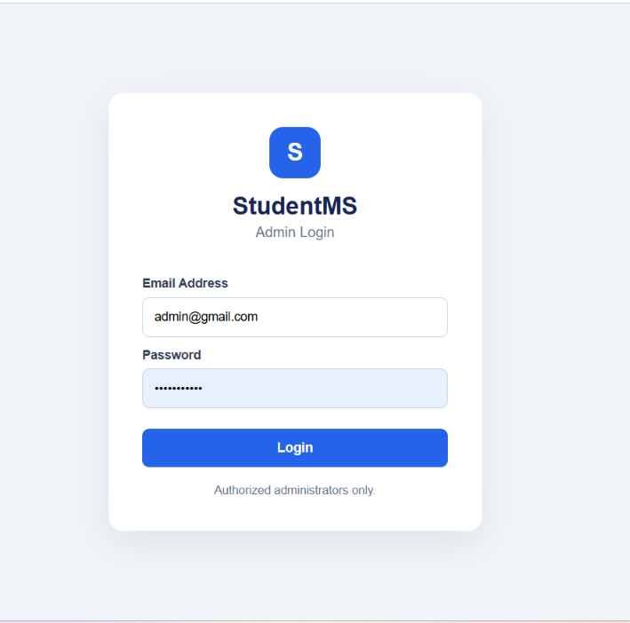
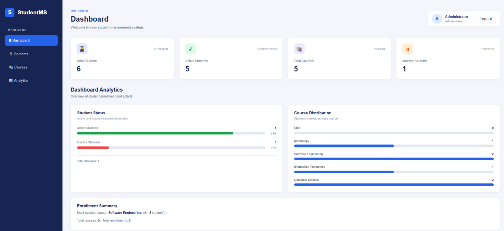
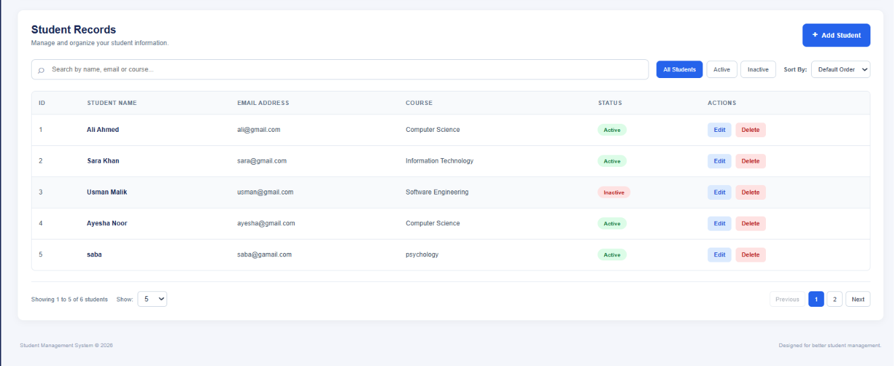
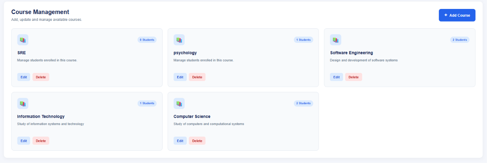

# Student Management System

A web-based Student Management System developed to manage student records, courses, and administrative operations through a dashboard.

## Features

- Admin Authentication (Login/Logout)
- Dashboard with Statistics
- Add, View, Edit and Delete Students
- Student Search
- Student Sorting
- Student Status Filtering
- Pagination
- Course Management
- MySQL Database Integration
- Responsive User Interface

## Technologies Used

### Frontend
- React.js
- JavaScript
- HTML
- CSS
- Axios
- Vite

### Backend
- Node.js
- Express.js
- REST API
- MySQL
- JWT Authentication

## Project Structure

Student Management System/
├── frontend/
├── backend/
├── .gitignore
└── README.md

## Installation and Setup

### 1. Clone the Repository

git clone YOUR_GITHUB_REPOSITORY_URL

### 2. Install Backend Dependencies

cd backend
npm install

### 3. Configure Environment Variables

Create a .env file inside the backend folder.

Add your database configuration and other required environment variables.

Never upload your actual .env file to GitHub.

### 4. Start Backend

npm run dev

### 5. Install Frontend Dependencies

Open another terminal:

cd frontend
npm install

### 6. Start Frontend

npm run dev

## Database

This project uses MySQL to store student, course, and administrator information.

Create and configure the required database before running the application.

## Developer

Aqsa Tahir

BS Information Technology Graduate

## Project Status

Completed - Development and initial system testing.

## Screenshots

### Login Page

### Dashboard

### Students Management

### Courses Management
